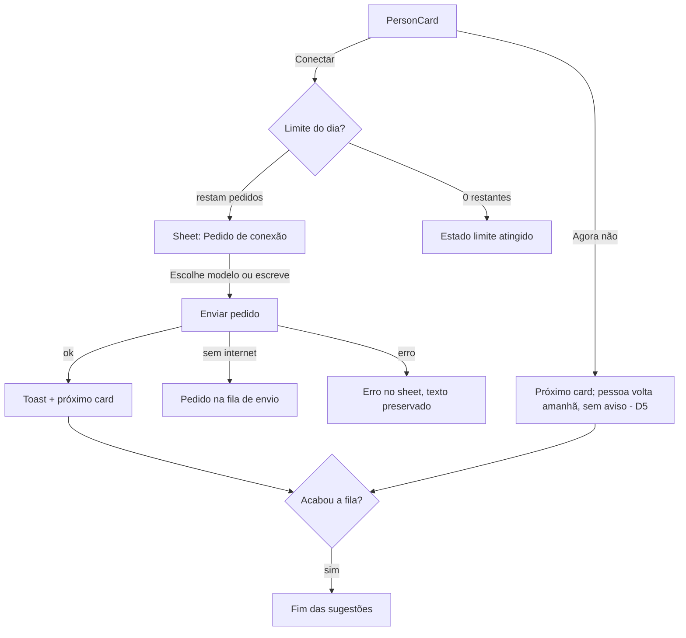

# Tela: C02 Conexões — Sugestões (VIP), com C04 Pedido de conexão   (história PT-### a definir pelo PO)

Componentes: `docs/design/design-system.md` (PersonCard, BottomSheet, Chip, Toast, EmptyState) · Decisões: D4 (limite), D5 (Agora não/Pendente), D6 (Pontos de Conexão), D8.

**Objetivo do usuário nesta tela:** no intervalo de 15 minutos, decidir rápido com quem vale conversar, com um motivo concreto, e mandar um pedido educado sem ter de escrever do zero. Sem sensação de vitrine de pessoas.

**Contexto do exemplo:** Porto Alegre, Dia 1, **12h35** (almoço). Aluno VIP: Rafael Moura, sócio da Moura Café Torrefação (varejo de alimentos). Objetivos: "Parcerias", "Busco clientes". Perfil ativado (C01 concluído), consentimento ligado. Usou 3 de 15 pedidos hoje.

**Fila de exemplo (fictícia):**
| # | Empresa · segmento · cidade | Pessoa · cargo · ingresso | Objetivo | Motivo (1 linha) | Afinidade |
|---|---|---|---|---|---|
| 1 | Kessler Móveis Planejados · Indústria moveleira · Porto Alegre | Renata Kessler · Sócia-diretora · VIP | Busca parcerias | 3 interesses em comum · vocês dois buscam parcerias no varejo | Alta |
| 2 | Fagundes Contabilidade Digital · Serviços contábeis · Porto Alegre | Diego Fagundes · Fundador · Diamond | Ofereço serviços | Ele atende empresas de alimentos · 2 interesses em comum | Alta |
| 3 | Ateliê Prates · Varejo de moda · Porto Alegre | Luciana Prates · Proprietária · VIP | Busco sócio | 4 interesses em comum · vocês dois vendem para o consumidor final | Boa |
| 4 | Bernardes Logística · Transporte e logística · Canoas | Thiago Bernardes · Diretor comercial · VIP | Busco clientes | Ele faz entregas para o varejo · 2 interesses em comum | Boa |
| 5 | Weber Agro Insumos · Agronegócio · Santa Cruz do Sul | Paulo Weber · CEO · Diamond | Investimento | Vocês dois têm interesse em expansão regional | Boa |

## Layout (de cima para baixo)

```
┌────────────────────────────────────────┐
│ Conexões              [Sino] [QR]      │ TopBar (QR = minha credencial)
├────────────────────────────────────────┤
│ Conexões              [Ler QR] [...]   │ cabeçalho da aba (h1 + ações)
│ (Sugestões)(Explorar)(Pedidos 4)(Rede) │ sub-navegação segmentada
├────────────────────────────────────────┤
│ Sugestão 1 de 12 · Restam 12 pedidos   │ caption tabular
│ ┌────────────────────────────────────┐ │
│ │ [Afinidade alta]                   │ │ PersonCard (surface.2)
│ │ Kessler Móveis Planejados          │ │
│ │ Indústria moveleira · Porto Alegre │ │
│ │ [Busca parcerias]                  │ │
│ │ ────────────────────────────────── │ │
│ │ 3 interesses em comum · vocês dois │ │
│ │ buscam parcerias no varejo         │ │
│ │ [v Varejo][v Expansão][v Gestão…]  │ │
│ │ ────────────────────────────────── │ │
│ │ (foto) Renata Kessler   [VIP]      │ │
│ │        Sócia-diretora              │ │
│ │ ┌──────────┐ ┌───────────────────┐ │ │
│ │ │Agora não │ │     Conectar      │ │ │ terço inferior
│ │ └──────────┘ └───────────────────┘ │ │
│ └────────────────────────────────────┘ │
└────────────────────────────────────────┘
[ Agora | Trilha | Conexões* | Materiais | Eu ]
```

| # | Bloco | Componente | Conteúdo | Notas |
|---|---|---|---|---|
| 1 | Topo | TopBar | Título "Conexões" · Sino · QR (minha credencial) | Global, igual às outras abas. |
| 2 | Cabeçalho | Título `h1` + 2 botões ícone | "Conexões" · **Ler QR** (ícone de scanner + rótulo curto "Ler QR", para não confundir com o QR da credencial) · Mais (…) | Mais abre sheet: "Meu perfil de Conexões", "Pausar meu perfil", "Privacidade". Sem a TopBar repetir o título: na aba Conexões a TopBar mostra só ícones e o cabeçalho leva o `h1`. |
| 3 | Sub-navegação | Chip segmentado, 4 itens, altura 40 (alvo 48), rola horizontalmente se a fonte crescer | **Sugestões** · Explorar · Pedidos `4` · Minha rede | Ativo: `surface.3` + `text.primary`; inativo: `text.secondary`. Contador de Pedidos tabular, só visível fora da palestra. Fica fixo ao rolar. |
| 4 | Linha de contexto | `caption` `text.secondary`, tabular | "Sugestão 1 de 12 · Restam 12 pedidos hoje" | O limite aparece antes de o usuário bater nele (prevenção de erro, H5). |
| 5 | Card | PersonCard | Kessler Móveis Planejados (linha 1 da fila) | Um card por vez, ocupa a altura útil; botões no terço inferior sem rolar. Ordem: afinidade → empresa → objetivo → motivo → interesses em comum → pessoa → ações. |
| 6 | Navegação | TabBar | Conexões ativa; badge "4" só no almoço/intervalo | — |

Por que um card por vez e não lista: força uma decisão consciente por pessoa (reduz pedido em massa, reclamação comum no mercado) e cabe no intervalo. Para varrer muitos perfis existe Explorar, com filtros.

## Fluxo Conectar → pedido (C04)



### Sheet "Pedido de conexão" (BottomSheet `tall`)
```
┌────────────────────────────────────────┐
│              ────                      │
│ Pedido para Renata Kessler         [X] │ h2
│ Kessler Móveis Planejados              │ caption
│                                        │
│ Escolha uma mensagem                   │ body-strong
│ (o) Vi que você busca parcerias no     │ opção 1 (selecionada)
│     varejo. Tenho uma torrefação...    │
│ ( ) Temos 3 interesses em comum...     │
│ ( ) Quero conhecer a Kessler Móveis... │
│ ( ) Escrever a minha                   │
│ ┌────────────────────────────────────┐ │
│ │ Oi, Renata. Vi que você busca      │ │ campo editável (surface.3,
│ │ parcerias no varejo. ...           │ │ borda border.strong)
│ └────────────────────────────────────┘ │
│                              212 / 280 │ caption tabular
│ Seus contatos só aparecem se ela       │ caption, ícone cadeado aberto
│ aceitar.                               │
│ ┌────────────────────────────────────┐ │
│ │           Enviar pedido            │ │ primário
│ └────────────────────────────────────┘ │
│ Restam 12 de 15 pedidos hoje           │ caption tabular, centralizado
└────────────────────────────────────────┘
```
| Item | Spec |
|---|---|
| Modelos | Radio list (alvo 48 por linha). Ao escolher, o texto vai para o campo, já com nome e empresa preenchidos, e pode ser editado. "Escrever a minha" limpa o campo e foca nele. |
| Modelo 1 (padrão, derivado do objetivo) | "Oi, Renata. Vi que você busca parcerias no varejo. Tenho uma torrefação e vendo para cafeterias e empórios. Vamos conversar no próximo intervalo?" |
| Modelo 2 (interesses) | "Oi, Renata. Temos 3 interesses em comum, entre eles expansão e gestão de equipes. Que tal trocarmos uma ideia no intervalo das 15h40?" |
| Modelo 3 (empresa) | "Oi, Renata. Quero conhecer melhor a Kessler Móveis Planejados. Podemos nos encontrar em um Ponto de Conexão?" |
| Campo | Máx. 280 caracteres, contador "212 / 280"; a 20 do limite fica `warning`; no limite, não aceita mais. Colar permitido. Vazio desabilita "Enviar pedido". |
| Contador do limite (D4) | "Restam 12 de 15 pedidos hoje" (VIP) / "de 25" (Diamond, proposta). Com 3 ou menos: `warning` "Restam 3 de 15 pedidos hoje". Pedidos por QR não contam e isso é dito no estado de limite. |
| Teclado | Sheet sobe com o teclado; "Enviar pedido" fica visível acima dele (WCAG 2.4.11). |
| Fechar | X, véu, arrastar ou voltar. Se o texto foi editado, fecha sem confirmação e guarda o rascunho até sair da aba (menos atrito que um diálogo). |

## Interações
| Ação | Resultado |
|---|---|
| Tocar no card (fora dos botões) | Abre C03 Perfil da pessoa (antes do aceite: sem contatos). |
| Conectar | Abre o sheet. Háptico: nenhum (ainda não é sucesso). |
| Enviar pedido | Botão em carregando; ao confirmar: sheet fecha, Toast "Pedido enviado para Renata Kessler", háptico leve, card sai e o próximo entra. Contador vai para "Restam 11". |
| Enviar durante uma palestra | Igual, com Toast "Pedido enviado. Renata recebe no próximo intervalo." (regra 5). |
| Agora não | Card sai sem confirmação; pessoa volta amanhã; nada é enviado a ela (D5). Toast "Renata volta para suas sugestões amanhã" com "Desfazer" (6 s). |
| Sub-navegação | Troca de painel sem animação; mantém a posição de cada painel. |
| Ler QR | Abre C10 (câmera). |

### Painéis irmãos (resumo; specs completas na Etapa 3)
| Painel | Conteúdo |
|---|---|
| Explorar (C06) | Busca + chips de filtro Segmento, Cidade, Objetivo, Ingresso; lista compacta de PersonCards (sem foto grande); mesmo par Conectar / Agora não. Sem filtro aplicado, mostra "Filtre por segmento para começar". |
| Pedidos (C05) | Recebidos: card com a mensagem recebida em destaque + "Aceitar" (primário) e "Agora não". Enviados: "Pendente" (nunca "Recusado", D5). |
| Minha rede (C09) | Lista de conexões aceitas com contatos (WhatsApp, LinkedIn, Instagram), nota privada, "Vamos nos ver?" (C08, Ponto A/B/C). |

## Estados
| Estado | Comportamento e microcopy |
|---|---|
| Fila com afinidade (padrão) | Como acima. |
| Carregando | Skeleton do PersonCard (mesma geometria). Linha de contexto: "Buscando pessoas com interesses em comum…" |
| Pedido enviado (card ainda visível, ex.: voltando do perfil) | Botões dão lugar a "Pedido enviado · Pendente" + ghost "Ver perfil". |
| **Limite atingido** | Linha de contexto vira StatusBanner `warning`: **"Você usou os 15 pedidos de hoje."** "Amanhã você tem 15 de novo. Pelo QR da credencial, os pedidos continuam liberados." No card, "Conectar" é substituído por botão secundário **"Conectar pelo QR"** (abre C10) e "Agora não" continua. A fila continua navegável para o aluno planejar o dia seguinte. |
| **Fim das sugestões** | EmptyState: ícone de linha · **"Você viu todas as sugestões de hoje"** · "Quem você deixou para depois volta amanhã. Enquanto isso, procure por segmento ou cidade." · botão secundário "Ir para Explorar". |
| Perfil pausado | EmptyState: "Seu perfil está pausado" · "Ninguém vê você nas sugestões e você não recebe pedidos." · primário "Reativar meu perfil". |
| Perfil não ativado | Abre C01 (Ativar perfil). Não faz parte desta tela. |
| Sem internet | Banner `offline`: "Sem internet. Você pode ver as sugestões salvas; os pedidos saem quando a conexão voltar." Enviar coloca o pedido na fila: Toast "Pedido salvo. Enviamos assim que a internet voltar." Card mostra "Envio pendente". O limite já desconta. |
| Erro ao enviar | No sheet, acima do botão, texto `danger`: "Não conseguimos enviar o pedido. Confira a internet e tente de novo." Texto preservado; botão "Tentar de novo". |
| Antes do evento (D8, proposta) | Chip "Proposta" ao lado do título e linha "Conexões abertas antes do evento". Restante igual. |

### Diamond (proposta, marcar com chip "Proposta")
| Item | Comportamento |
|---|---|
| Selo | TierBadge Diamond no PersonCard de quem é Diamond (aprovado no brief §3: selo do ingresso no perfil). |
| Limite | 25 por dia (D4, proposta): "Restam 22 de 25 pedidos hoje". |
| Destaque | Recomendação do designer (ver design-system.md F5): o destaque vale **na caixa de Pedidos de quem recebe** — pedido de Diamond fica no topo, com borda `border.gold` e chip "Proposta". A ordem das Sugestões continua só por afinidade. Se a diretoria preferir prioridade nas Sugestões, o PersonCard Diamond ganha borda `border.gold` + `glow.gold` e chip "Proposta", e aparece no máximo 1 a cada 5 cards. |

## Validações e mensagens
| Situação | Mensagem | Ação |
|---|---|---|
| Campo vazio | (sem mensagem; botão desabilitado) | — |
| 260+ caracteres | Contador em `warning` | — |
| Limite atingido | "Você usou os 15 pedidos de hoje." | Conectar pelo QR |
| Pessoa pausou o perfil entre a fila e o envio | "Renata pausou o perfil. O pedido não foi enviado e não conta no seu limite." | Próximo card |
| Erro de rede | "Não conseguimos enviar o pedido. Confira a internet e tente de novo." | Tentar de novo |
| Erro desconhecido | "Algo deu errado do nosso lado. Tente de novo em instantes." | Tentar de novo |

## Acessibilidade
- Ordem: TopBar → título "Conexões" (`heading`) → Ler QR → Mais → sub-navegação (`role="tablist"`, cada item `tab` com `aria-selected`; "Pedidos, 4 novos") → linha de contexto → card (grupo com rótulo único, ver design-system PersonCard) → Agora não → Conectar → TabBar.
- Botões com nome da pessoa: "Conectar com Renata Kessler", "Agora não para Renata Kessler".
- Troca de card anunciada: "Próxima sugestão: Fagundes Contabilidade Digital." (`polite`).
- Sheet: foco no título ao abrir; radio group rotulado "Escolha uma mensagem"; contador do campo anunciado só a 20 do limite; erro com `role="alert"`.
- Sem gesto de arrastar obrigatório (sem swipe; ver design-system.md F4).
- Contraste: selo "Afinidade alta" #020111 sobre dourado (7,49:1+); chips Em comum `gold.200` sobre `surface.2` (11,64:1).

## Movimento
| Gatilho | Propósito | Propriedade | Duração | Reduzido | Háptico |
|---|---|---|---|---|---|
| Card sai após Conectar/Agora não | Continuidade | translateX -24 + opacity | base | opacity | leve só no envio |
| Próximo card entra | Continuidade | opacity + translateY 8 | base | opacity | — |
| Sheet | Continuidade | translateY + véu | slow | opacity | — |
| Desfazer "Agora não" | Continuidade | card volta (inverso) | base | opacity | — |

## Diferenças Android x iOS
Voltar do Android fecha o sheet antes de sair da aba. Teclado: `inputMode="text"`, autocorreção ligada no campo de mensagem.

## Eventos de analytics (validar com o PO)
`suggestion_viewed {position, affinity}` · `connect_tapped` · `request_sent {template: 1|2|3|custom, edited: bool, during_session: bool}` · `not_now_tapped` · `not_now_undone` · `daily_limit_reached {tier}` · `suggestions_exhausted` · `subnav_changed {to}`.

## Dúvidas para o PO
1. O limite diário renova à meia-noite ou na abertura do dia (9h)? A spec diz "amanhã" sem hora até decidir.
2. Pedido que fica na fila offline desconta o limite na hora (proposta) ou só ao sair?
