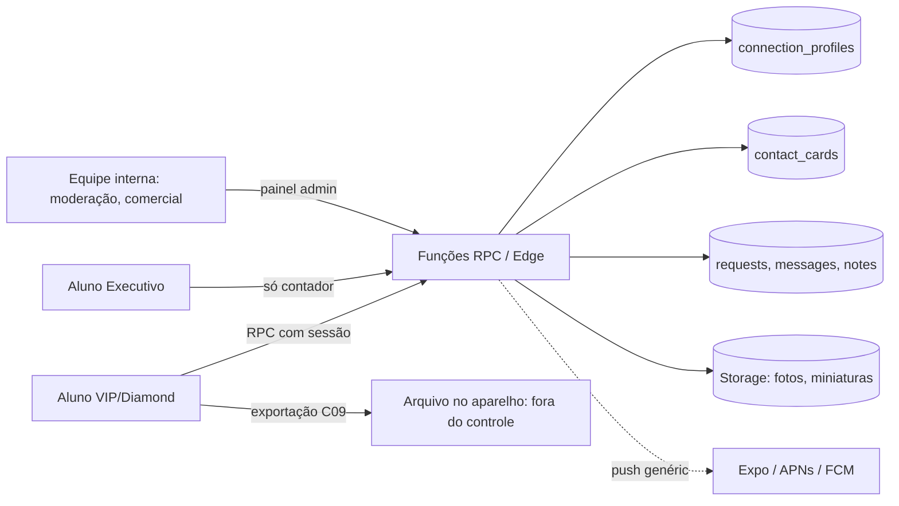

# LGPD e privacidade das Conexões

Data: 2026-11-26 · Dono: security-engineer · Base: commit `0b17e47` (mockup com DEC-002) · Status: parecer da Fase 1 (opinião; nada aqui é construído agora)

Escopo lido: `apps/mockup/src/screens/connections/` (C00, C01, C03, C05, C06, C09, C11, edição de perfil), `screens/me/PrivacyScreen.tsx` (U03), `MeScreen.tsx` (U01), `LoginScreen.tsx`/`CodeScreen.tsx` (E01/E02), `lib/format.ts`, `lib/connections.ts`, `data/participants.ts`, `data/content.ts`, `data/notifications.ts`; `docs/decisoes.md` (D4, D5, D7, DEC-002), `docs/produto/decisoes-diretoria.md` (DD-04, DD-06), `docs/arquitetura/recomendacao-stack.md` (§4 e §6), `docs/design/design-system.md` (F2).
Fora do escopo: chat (C07) e encontro (C08) só por leitura rápida; nada foi executado no navegador.

Não sou advogado. Bases legais, artigos e prazos abaixo foram escritos de memória da Lei 13.709/2018 e **precisam de validação do jurídico do Grupo Virtus** antes da política de privacidade.

## 1. Resumo

- O mockup acerta o essencial: consentimento desligado por padrão, contato só após aceite, recusa invisível (D5), prévia do Executivo abstrata (sem nome nem rosto no DOM), CPF sempre mascarado, exclusão pelo app, bloquear/denunciar/pausar em todo perfil.
- Nenhum achado Crítico ou Alto no mockup. Há 8 ajustes de texto e fluxo (SEC-001 a SEC-008) que devem entrar **antes da demo à diretoria**, porque ela vai aprovar o fluxo pelo que vê.
- Para o app real há 2 requisitos Altos (SEC-009 uso comercial/Olimpo e SEC-010 contato antes do aceite), que bloqueiam o lançamento se não forem atendidos.

## 2. Tabela LGPD (uma linha por dado e finalidade)

Bases: I consentimento, V execução de contrato, VI exercício regular de direitos, IX legítimo interesse (art. 7). `[validar com jurídico]` em todas.

| Dado | Finalidade | Base legal | Quem vê e quando | Retenção (proposta) | Como o titular revoga ou exclui |
|---|---|---|---|---|---|
| Nome, e-mail, ingresso (edição, tier) | Login, credencial, regras de acesso | V | Só o próprio aluno; equipe de credenciamento | Conta: até o titular excluir ou [prazo pós-evento a definir]; mínimo do ingresso conforme obrigação legal | "Excluir meus dados" (U03); conta: ver SEC-014 |
| CPF | Login alternativo e casamento com a lista do credenciamento | V (minimizar: DD-06 opção B/C) | Ninguém em claro; app recebe só a máscara | HMAC + máscara enquanto houver conta | Exclusão da conta |
| Perfil de Conexões: nome, ingresso, foto, empresa, cargo, cidade, segmento, nicho, objetivos, objetivo no Protagon, interesses | Sugerir conexões e ser encontrado | I (finalidade 1) | VIP/Diamond da **mesma edição**, com consentimento ativo, não pausado, não bloqueado | Sai do pool no fim do evento; apagado com a rede em 90 dias (D7). Outra edição: novo aceite, com dados pré-preenchidos | Pausar, desligar perfil, excluir (U03) |
| Maior desafio e "Domina" (DEC-002) | Afinidade ("ela domina o seu maior desafio") | I (finalidade 1) | Idem; desafio com chave própria de visibilidade (SEC-003). **Nunca a equipe comercial** (SEC-009) | Idem perfil | Editar, ocultar, excluir |
| Miniatura borrada da foto (só se a diretoria escolher foto real no C00) | Mostrar ao Executivo que há gente se conectando | I separado (finalidade 2) | Executivos da edição, sem nome/empresa/id | Apagada na hora ao revogar ou pausar | Chave própria, desligada por padrão (SEC-006) |
| WhatsApp, LinkedIn, Instagram | Continuar a conversa fora do app | I (finalidade 3) | Só conexões com aceite mútuo; a pessoa conectada pode salvar e exportar (C09) | No app: 90 dias. Cópia exportada: fora do controle do Grupo | Desfazer conexão, excluir; o que o outro já salvou não volta (dizer isso) |
| Instagram antes do aceite (opção de U03) | Conhecer a pessoa antes de pedir conexão | I separado (finalidade 4) | VIP/Diamond da edição que também ligaram a opção (recíproco) | Enquanto ligado | Desligar em U03 (efeito imediato) |
| Pedido de conexão e mensagem (C04) | Pedir conexão | I (finalidade 1) | Remetente e destinatário | 90 dias após o evento | Exclusão |
| Chat (C07) e encontros (C08) | Combinar e encontrar no evento | I (finalidade 1) | Os dois conectados; moderação lê só o que foi denunciado | 90 dias (D7) | Desfazer conexão, excluir |
| Notas privadas (C09) | Memória do aluno | V (serviço pedido pelo autor) | Só o autor; entram na exportação dele | 90 dias | Exclusão. `[jurídico]` são dados de terceiro: definir resposta se o outro pedir acesso |
| Bloqueios | Segurança do titular | IX | Ninguém | Enquanto a conta existir, inclusive em outras edições | Desbloquear (não existe no mockup; avaliar) |
| Denúncias | Moderação, segurança, defesa em processo | IX e VI (teste de balanceamento escrito) | Equipe de moderação nomeada | [1 a 2 anos, jurídico] mesmo após exclusão da conta do denunciado | Não revogável pelo denunciado; acesso mediante pedido |
| Registro de consentimento (finalidade, versão do texto, data, origem) | Provar o consentimento (ônus do controlador) | VI | Interno | Duração do tratamento + prazo prescricional [jurídico] | Não excluível enquanto necessário à prova |
| Token de push, eventos de uso (`app_events`), logs | Avisos e métricas | V e IX | Operadores Expo/APNs/FCM/Sentry (fora do Brasil) | Token: até sair/excluir. Eventos e logs: 90 dias [proposta] | Sair, excluir, desligar notificações |

Operadores a registrar e contratar: Supabase, Expo, Apple/Google (push), Sentry, provedor de e-mail, Hotmart (origem). Transferência internacional: push e Sentry sem dado pessoal no corpo.

## 3. Threat model curto



Fronteiras: aparelho (não confiável) ↔ RPC; RPC ↔ tabelas sob RLS; equipe interna ↔ dados (o maior risco de desvio de finalidade); arquivo exportado (sai de qualquer controle).

| STRIDE | Ameaça nas Conexões | Controle (existe no desenho / falta) |
|---|---|---|
| S | Perfil com nome de outra pessoa (comprador ≠ participante, DD-06) ou cargo/empresa inventados | Cadastro só por compra (stack §4); nome travado no C01. Falta: vínculo com o credenciamento (SEC-012) |
| T | App adulterado tira o limite diário ou ativa perfil sem consentimento | Escritas só por RPC (stack §4). Falta: RPC de ativação exige registro de consentimento da versão vigente (SEC-015) |
| R | "Nunca aceitei mostrar meu perfil" / "não mandei essa mensagem" | Tabela `consents` com versão; mensagens com autor e data |
| I | Contato antes do aceite por join descuidado; raspagem do pool; nome em push na tela bloqueada; miniatura com id | Tabelas separadas por sensibilidade (stack §4). Falta: matriz de testes de RLS (SEC-010), limites de leitura (SEC-011), push genérico (SEC-016) |
| D | Denúncias em massa derrubam um concorrente; enxurrada de pedidos | Limite diário D4. Falta: suspensão por denúncia só com revisão humana (SEC-013) |
| E | Executivo (ou ex-VIP após reembolso) lê perfis via API; equipe comercial consulta desafios | Tier lido do banco, não do JWT (stack §4). Falta: papel interno sem acesso a Conexões (SEC-009); revogação no reembolso (pergunta 7 da stack) |

Casos de abuso do networking:

| Abuso | Ator | Sinal de detecção | Controle mínimo |
|---|---|---|---|
| Assédio por pedido, chat ou no encontro presencial | Participante | Denúncias, muitos pedidos sem aceite, mensagens repetidas | Recusa invisível (D5, existe); bloquear em cascata; denúncia com motivo "assédio", opção de bloquear junto e rota urgente com a equipe no local (SEC-005, SEC-013); encontros só em Pontos de Conexão públicos (D6, existe) |
| Assédio fora do app via Instagram liberado antes do aceite | Participante | Não detectável pelo app | Opção desligada por padrão (existe); aviso de que bloquear aqui não vale lá (SEC-004) |
| Raspagem da lista de VIP/Diamond (nome, empresa, cargo, desafio, @) | Vendedor com ingresso VIP, concorrente | Muitos perfis abertos ou páginas do Explorar por hora | RPC paginada com campos mínimos, sem `select` direto; teto de perfis vistos por dia; alerta; termos de uso proibindo (SEC-011) |
| Perfil falso ou ingresso de terceiro | Revendedor, golpista | Denúncia "perfil falso"; nome diferente no credenciamento | Selo "credenciado" após check-in; Conexões com pedidos só após credenciamento; suspensão preventiva com revisão (SEC-012) |
| Uso comercial dos contatos por participantes (listas de transmissão, prospecção) | Participante vendedor | Denúncia "spam" | Aviso na exportação; termos de uso; exportar só canais que o outro liberou (SEC-007) |
| Uso comercial pelo organizador (leads do Olimpo com foto, desafio, rede) | Insider/comercial | Consulta interna às tabelas de Conexões | Proibido por padrão; consentimento separado; papel sem acesso; log de acesso (SEC-009) |
| Retaliação após recusa | Participante | — | "Pendente", nunca "Recusado" (D5, existe); bloqueio sem aviso (existe) |
| Denúncia em massa contra concorrente | Concorrente | Várias denúncias em minutos de contas ligadas | Sem suspensão automática; revisão humana |

Pontuação (probabilidade × impacto, 1 a 3): uso comercial pelo organizador 2×3=6; contato antes do aceite 2×3=6; assédio 2×3=6 (mitigado pelo desenho); raspagem 3×2=6 → controle obrigatório antes do piloto; perfil falso 2×2=4; denúncia em massa 1×2=2.

Risco residual que o fundador deve aceitar por escrito em `docs/decisoes.md`: contatos já compartilhados e exportados ficam com a outra pessoa para sempre; o Instagram liberado antes do aceite sai da moderação do app.

## 4. Achados

### (a) Ajustes no mockup agora (texto e fluxo)

```
SEC-001 | Severidade: Média | Status: Aberto
Onde: apps/mockup/src/screens/connections/ActivateScreen.tsx:211-220 (C01, passo 3)
Problema: o consentimento é uma frase genérica ("Autorizo mostrar meu perfil..."). Não diz quais dados aparecem (nicho, objetivo no Protagon, desafio, foto), que contatos são liberados após o aceite e podem ser exportados, por quanto tempo ficam, nem que não há uso comercial; não tem link para a política.
Cenário de ataque: consentimento não informado tende a ser contestável (autorizações genéricas são nulas, art. 8 §4, de memória); a diretoria aprova um fluxo que o jurídico depois reescreve, e o "< 60 s" é medido com o texto errado.
Correção recomendada: trocar pelo texto da seção 5 (chave + 4 linhas + link "Política de privacidade"); manter desligado por padrão.
Como verificar a correção: no C01 passo 3, o texto lista dados, contatos, exportação, 90 dias e uso; a chave começa desligada; o link existe.
```

```
SEC-002 | Severidade: Média | Status: Aberto
Onde: ActivateScreen.tsx (passo 3) e ProfileEditScreen.tsx:111-128; contatos vêm prontos de data/content.ts:54-67
Problema: o titular não escolhe quais contatos libera após o aceite. WhatsApp e LinkedIn aparecem para a conexão sem nunca terem sido pedidos ou mostrados a ele; só o Instagram é editável.
Cenário de ataque: no app real, o telefone da compra (Hotmart) vira contato público para cada conexão sem escolha do titular: dado usado para finalidade diferente da coletada.
Correção recomendada: bloco "Depois do aceite, você compartilha" em C01 passo 3 (ou em "Complete seu perfil"), com WhatsApp, LinkedIn e Instagram, cada um com o valor e uma chave; o telefone da compra só pré-preenche, editável.
Como verificar a correção: o aluno vê e desliga cada canal; o C03 da outra pessoa mostra só os canais ligados.
```

```
SEC-003 | Severidade: Média | Status: Aberto
Onde: ActivateScreen.tsx:16-22 e PrivacyScreen.tsx:11-17 (lista de campos visíveis); ProfileScreen.tsx:150-212 (C03)
Problema: os campos de DEC-002 (nicho, objetivo no Protagon, maior desafio, "Domina") e a foto não aparecem em "O que fica visível" nem em U03. "Maior desafio" expõe fragilidade do negócio ("organizar o caixa", "preparar a sucessão") e é exatamente o dado que atrai abordagem de venda.
Cenário de ataque: vendedor com ingresso VIP filtra quem tem o desafio que ele "resolve" e aborda em massa; o titular não sabia que o desafio estava visível.
Correção recomendada: em C01 passo 3, informar "Também aparecem: nicho e objetivo no Protagon; foto, se você adicionar". Em U03 e em "Complete seu perfil", chave "Mostrar meu maior desafio" (ligada só se o aluno preencher). Se desligada, o desafio continua servindo às sugestões dele, mas o motivo "ela domina o seu maior desafio" não aparece para os outros. Explorar não deve filtrar por desafio (hoje não filtra: manter).
Como verificar a correção: com a chave desligada, o C03 visto por outro não mostra "Maior desafio" nem o motivo derivado dele.
```

```
SEC-004 | Severidade: Baixa | Status: Aberto
Onde: PrivacyScreen.tsx:72-80 (U03, Instagram antes da conexão)
Problema: a dica não avisa que o Instagram fica fora do app: bloquear e denunciar aqui não valem lá, e a pessoa pode mandar direct sem aceite. A reciprocidade e o padrão desligado estão corretos.
Cenário de ataque: aluna libera o @, recusa (ou bloqueia) alguém e continua recebendo mensagens no Instagram; a percepção é de que o app expôs.
Correção recomendada: dica "Seu @ aparece para VIP e Diamond desta edição antes do aceite, e você vê o @ de quem também liberou. No Instagram, bloquear e denunciar daqui não valem. Desligado por padrão."
Como verificar a correção: texto presente; chave continua desligada por padrão.
```

```
SEC-005 | Severidade: Média | Status: Aberto
Onde: SafetySheet.tsx:11, 89-99 (C11, denunciar)
Problema: não há motivo "assédio ou comportamento inadequado" (inclusive no encontro presencial), não há opção de bloquear junto, e a promessa "analisa em até 24 h" é lenta para um evento de 3 dias e não tem rota urgente.
Cenário de ataque: assédio no Ponto de Conexão às 15h40; a resposta chega depois do fim do evento e a vítima continua recebendo mensagens.
Correção recomendada: motivos "Assédio ou comportamento inadequado", "Mensagem ofensiva", "Perfil falso ou de outra pessoa", "Oferta indevida ou spam", "Outro motivo"; caixa "Bloquear [nome] também" marcada; confirmação "Denúncia enviada. Durante o evento, a equipe analisa no mesmo dia. Se for urgente, procure a equipe no estande." (SLA a definir com Eventos, DD-09).
Como verificar a correção: denunciar com a caixa marcada também bloqueia e fecha o perfil/chat.
```

```
SEC-006 | Severidade: Média (decisão) | Status: Aberto
Onde: docs/arquitetura/recomendacao-stack.md:55 (miniatura borrada real) x LockedPreview.tsx:5-38 (cards abstratos)
Problema: o mockup está certo (cards abstratos, nada pessoal); a stack propõe miniatura real borrada. Usar a foto de um VIP para vender upgrade a outro aluno é finalidade de marketing, distinta da finalidade 1.
Cenário de ataque: aluno reconhece a si mesmo (ou é reconhecido pelo cabelo, cor, fundo) num anúncio de upgrade sem ter autorizado.
Correção recomendada: manter cards abstratos também no app real (o contador já entrega o argumento de venda; F1). Se a diretoria quiser fotos, segunda chave no C01, separada e desligada: "Usar minha foto, desfocada e sem nome, na prévia de Conexões para quem ainda não tem acesso". Sem essa chave, a foto nunca vai para a prévia.
Como verificar a correção: decisão registrada em docs/decisoes.md; se fotos, a chave existe e começa desligada.
```

```
SEC-007 | Severidade: Média | Status: Aberto
Onde: NetworkPanel.tsx:76-95 (C09, exportar contatos)
Problema: a exportação tira contatos de terceiros do controle do app sem nenhum aviso de uso, e o texto lista todos os canais, não só os que cada pessoa liberou; as notas privadas vão junto.
Cenário de ataque: participante exporta 30 contatos e os coloca numa lista de transmissão comercial; as pessoas culpam o Protagon.
Correção recomendada: abaixo do botão: "O arquivo traz só os contatos que cada pessoa liberou e as suas notas. Use para falar com essas pessoas; não adicione a listas de transmissão ou de vendas." Conexões desfeitas, bloqueadas ou excluídas não entram.
Como verificar a correção: texto presente; no app real, teste de que conexão desfeita não sai no arquivo.
```

```
SEC-008 | Severidade: Baixa | Status: Aberto
Onde: textos imprecisos em U03 e C11 (PrivacyScreen.tsx:85, 125, 168; SafetySheet.tsx:143, 176; data/content.ts:51) e máscara de CPF (lib/format.ts:11-15 x stack:66)
Problema: (1) "Pausar: ninguém vê você" é inexato se as conexões já feitas continuam vendo; (2) "Desfazer conexão: contatos somem para os dois" promete apagar o que o outro já salvou; (3) "exclusão imediata" ignora backups; (4) "Tratamos seus dados com base na sua autorização" vale só para Conexões (ingresso é contrato); (5) mockup mostra os 6 dígitos do meio (***.482.917-**) e a stack fala em guardar só os 2 últimos: escolher um padrão. U01 nem precisa exibir CPF.
Cenário de ataque: promessa falsa ao titular vira reclamação na ANPD ou no Procon.
Correção recomendada: (1) "Você some das sugestões e da busca e não recebe pedidos novos. Suas conexões continuam." (confirmar regra com PO); (2) "deixam de aparecer no app para os dois. O que já foi salvo fora do app não é apagado."; (3) "Apagamos do app na hora. Cópias de segurança são apagadas em até [N] dias."; (4) "Seu perfil de Conexões só existe com a sua autorização. Os dados do ingresso servem para o seu acesso ao evento. Chat e Minha rede ficam 90 dias após o evento. Política de privacidade."; (5) padrão ***.482.917-** em todo lugar, ou tirar o CPF do U01.
Como verificar a correção: QA confere os 5 textos.
```

### (b) Requisitos para o app real

```
SEC-009 | Severidade: Alta | Status: Aberto (bloqueia lançamento)
Onde: desenho (DD-04; brief §1: Protagon é o principal canal de leads do Olimpo)
Problema: perfil, foto, maior desafio, objetivo no Protagon, rede e chat são dados perfeitos para qualificar lead. Usá-los para vender o Olimpo é outra finalidade; agrupar no consentimento das Conexões o torna nulo.
Cenário de ataque: comercial liga para quem marcou "Captar investimento" como desafio; aluno percebe que o perfil de networking virou ficha de vendas; dano de reputação e risco na ANPD.
Correção recomendada: diretoria registra "proibido por padrão"; se quiser, consentimento separado, fora do C01, desligado, nunca condição para usar Conexões, só com dados do próprio titular (nunca rede, chat, notas ou contatos de terceiros). Papel interno do comercial sem acesso às tabelas de Conexões; log de acesso de quem consulta.
Como verificar a correção: decisão em docs/decisoes.md; teste de RLS com papel "comercial" negado; texto do opt-in validado pelo jurídico.
```

```
SEC-010 | Severidade: Alta | Status: Requisito
Onde: modelo de dados (stack:49-50)
Problema: a regra 3 (contato só após aceite mútuo) depende de RLS e de RPC; um join, uma view ou um DTO descuidado devolve telefone antes do aceite.
Correção recomendada: manter `contact_cards` separada; leitura só por RPC que confere conexão aceita, não bloqueada e consentimento 3 vigente; matriz de testes de RLS no CI (sem conexão, pendente, recusado, bloqueado, desfeito, Executivo, outra edição, pausado, reembolsado) esperando zero linhas; Instagram antecipado exige as duas chaves ligadas.
Como verificar a correção: suíte de RLS verde no CI; revisão de segurança antes do piloto.
```

```
SEC-011 | Severidade: Média | Status: Requisito
Raspagem do pool (C02, C06, C03). Sem `select` direto em `connection_profiles`; RPC paginada com campos mínimos (sem desafio quando oculto, sem @ fora do perfil individual); teto de perfis abertos por dia [proposta 100] e alerta acima dele; termos de uso proibindo coleta; nada de lista de @ no Explorar.
```

```
SEC-012 | Severidade: Média | Status: Requisito
Perfil falso e ingresso de terceiro (DD-06). Nome do perfil = nome do participante confirmado no credenciamento, não do comprador; selo "credenciado" após check-in; avaliar pedidos só após credenciamento (casa com DD-05); denúncia "perfil falso" tira do pool após revisão humana, não automaticamente.
```

```
SEC-013 | Severidade: Média | Status: Requisito
Assédio e moderação. Bloqueio em cascata no servidor (some do Explorar e das sugestões, cancela pedidos pendentes, impede QR e novo pedido, vale em outras edições); denúncia guarda a mensagem denunciada como evidência; fila com pessoa nomeada de plantão nos 3 dias e SLA escrito; equipe lê só o que foi denunciado; sem suspensão automática por volume (evita denúncia em massa); teste de balanceamento do legítimo interesse para reter denúncias.
```

```
SEC-014 | Severidade: Média | Status: Requisito
Exclusão e retenção. Purge por pg_cron em 90 dias (D7) cobrindo perfil, foto, miniatura, pedidos, chat, encontros e notas; perfil sai do pool no fim do evento; consentimentos e denúncias com prazo próprio; janela de backup escrita no texto de exclusão; prazo de resposta a pedido do titular [jurídico]. Lojas `[HIPÓTESE: confirmar regras vigentes]`: Apple pede exclusão de conta no app e Google pede exclusão no app e por link web; contas criadas pela compra provavelmente contam: oferecer "Excluir minha conta" além de "Excluir meus dados".
```

```
SEC-015 | Severidade: Média | Status: Requisito
Registro de consentimento. Tabela `consents` por finalidade (1 perfil, 2 foto na prévia, 3 contatos após aceite, 4 Instagram antecipado, 5 eventual Olimpo), versão e hash do texto, data, origem; RPC de ativação recusa sem consentimento 1 da versão vigente; texto novo exige novo aceite; revogação tem efeito imediato pela RLS (stack §6).
```

```
SEC-016 | Severidade: Baixa | Status: Requisito
Fotos e notificações. Upload: remover EXIF/GPS, limitar tipo e tamanho, bucket privado com URL assinada, moderação de imagem ofensiva por denúncia. Push com corpo genérico ("Você tem um novo pedido de conexão"), nome só dentro do app (tela bloqueada e operadores fora do Brasil); a central de notificações do mockup pode manter nomes.
```

```
SEC-017 | Severidade: Média | Status: Requisito
Login e enumeração (E01/E02, stack:53). "Ingresso não encontrado" revela se um CPF ou e-mail comprou o Protagon. Rate limit por IP e aparelho, captcha invisível, OTP com expiração curta e tentativas limitadas. No login por CPF, não mostrar o e-mail mascarado (a stack sugere mostrar; o mockup já não mostra: manter "o e-mail cadastrado").
```

Governança mínima antes do piloto (dono entre colchetes): política de privacidade e termos de uso com link no C01 e em U03 [jurídico]; RIPD das Conexões [security + jurídico]; encarregado (DPO) e canal indicados [Grupo Virtus]; contratos com operadores [jurídico]; Data Safety e App Privacy preenchidos a partir da seção 2 [security]; idade mínima 18 anos para Conexões `[validar]`; processo de incidente com prazo de comunicação à ANPD `[validar prazo vigente]`.

## 5. Texto proposto para o consentimento do C01 (passo 3)

Logo acima da chave, uma linha fixa: "Também aparecem: nicho e objetivo no Protagon; foto, desafio e conhecimentos, se você preencher."

Chave (desligada por padrão; sem ela o perfil não ativa):

> **Autorizo mostrar meu perfil de Conexões para participantes VIP e Diamond desta edição.**
> - Usamos esses dados só para sugerir conexões e marcar encontros. Não usamos para venda de outros produtos. `[depende de DD-04]`
> - WhatsApp, LinkedIn e Instagram só aparecem para quem aceitar a conexão com você. Essa pessoa pode salvar e exportar seus contatos.
> - Chat e Minha rede ficam 90 dias após o evento.
> - Você pode pausar, desligar ou excluir quando quiser, em Eu > Privacidade. [Política de privacidade]

Abaixo, quando desligada: "Sem a autorização, o perfil não é ativado." (já existe).

Segunda chave, **só se** a diretoria escolher foto real na prévia do Executivo (SEC-006; recomendo não usar), desligada e opcional:

> Usar minha foto, desfocada e sem nome, na prévia de Conexões para quem ainda não tem acesso.

Notas: ~70 palavras, leitura em cerca de 20 s; cabe no "< 60 s". O nome do controlador (razão social do Grupo Virtus) entra na política, não na chave. O texto final é do jurídico; o designer ajusta forma sem tirar nenhum dos 4 itens.

## 6. Limites desta revisão

- Revisão de código e documentos de um mockup com dados fictícios; não há backend para testar. RLS, rate limit e purge só se provam com testes no app real e um pentest antes de escalar para várias edições.
- Regras das lojas e artigos da LGPD não foram reconferidos nesta sessão.
- Decisões pedidas: DD-04 (uso comercial, SEC-009), foto na prévia (SEC-006), regra de pausa vs. conexões existentes (SEC-008, PO), SLA de denúncia (SEC-005, Eventos).
